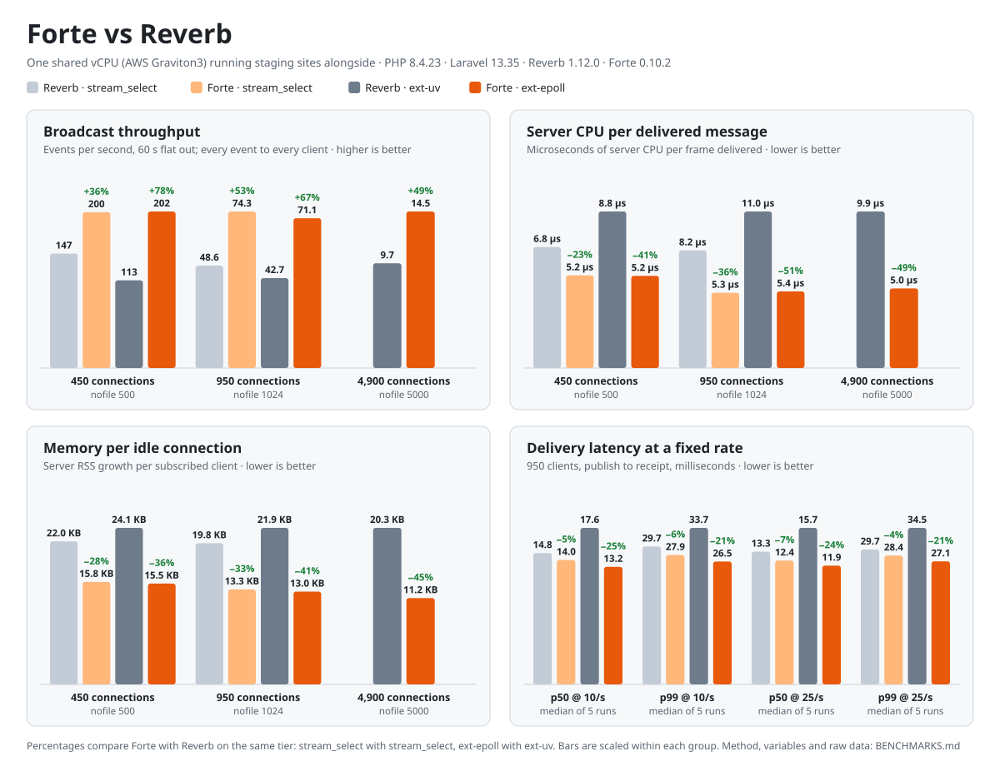

# Benchmarks

Forte 0.10.2 against Laravel Reverb 1.12.0, on the kind of box most Reverb servers run on: one shared vCPU with other sites on it. Every number here comes from the JSON files in [`benchmarks/results/`](benchmarks/results/), which the harness in [`benchmarks/harness/`](benchmarks/harness/) wrote. [`benchmarks/charts.py`](benchmarks/charts.py) draws the chart and prints the tables below from those files.

<picture>
  <source media="(prefers-color-scheme: dark)" srcset="benchmarks/forte-vs-reverb-dark.svg">
  
</picture>

## Summary

Each loop is compared with its counterpart: `stream_select` with `stream_select`, and Forte on ext-epoll with Reverb on ext-uv, the extension each project recommends. Forte on ext-epoll against Reverb on ext-uv:

| | 450 connections | 950 connections | 4,900 connections |
|---|---:|---:|---:|
| Broadcast throughput, 60 s | **+78%** (201.5 vs 112.9 events/s) | **+67%** (71.1 vs 42.7) | **+49%** (14.5 vs 9.7) |
| Server CPU per delivered message | **−41%** (5.20 vs 8.84 µs) | **−51%** (5.36 vs 10.95 µs) | **−49%** (5.05 vs 9.92 µs) |
| Memory per idle connection | **−36%** (15.5 vs 24.1 KB) | **−41%** (13.0 vs 21.9 KB) | **−45%** (11.2 vs 20.3 KB) |
| Subscribe every client | tie (0.75 s) | **0.75 vs 1.25 s** | **3.26 vs 5.26 s** |
| p50 / p99 latency at 25 events/s | | **−24% / −21%** (11.9 / 27.1 vs 15.7 / 34.5 ms) | |

On `stream_select`, with no extension installed, Forte delivered 36% more events per second at 450 connections and 53% more at 950. It used 23% and 36% less CPU per message, held 28% and 33% less memory per connection, and had lower p50 and p99 latency at both fixed rates.

Every cell delivered 100% of its events to every client, and every publish returned 200. [Where Forte didn't win](#where-forte-didnt-win) covers the numbers that go the other way and why.

## The box

| | |
|---|---|
| Machine | AWS EC2, Graviton3 (Arm Neoverse-V1), **1 vCPU**, 3.8 GB RAM |
| OS | Ubuntu 24.04.4 LTS, Linux 6.17.0-1019-aws, aarch64 |
| Neighbours | A Forge-managed server running staging sites the whole time: PHP-FPM and Horizon queue workers. Nothing was stopped for the benchmark. |
| PHP | 8.4.23 CLI, NTS, OPcache off for the CLI (so no JIT), `memory_limit=-1` for every bench process |
| Network | Loopback only. Server on `127.0.0.1:9090`, clients bound to `127.0.0.2` and up, publisher on `127.0.1.x` |
| Date | 2026-10-12 |

A single shared core is the point, not a caveat. It's the smallest box Forge and most hosts sell, and it's where a WebSocket server has to share the CPU with the app it serves. The server, the load clients and the publisher all ran on that one core, so the server's CPU cost per message shows up directly as throughput.

## Software

Two fresh Laravel 13.35.0 apps that differ only in their WebSocket server.

| | Reverb app | Forte app |
|---|---|---|
| Server | `laravel/reverb` 1.12.0 | `projectsaturnstudios/forte` 0.10.2 |
| Install | `composer require laravel/reverb -W` (`-W` lets Composer move `guzzlehttp/psr7` from 3.1.0 to 2.13.1 to satisfy Reverb's constraints) | `composer require projectsaturnstudios/forte` |
| Event loop | `react/event-loop` 1.6.0 on `StreamSelectLoop`, or on `ExtUvLoop` with [ext-uv](https://pecl.php.net/package/uv) 0.3.1 and libuv 1.48.0 loaded | Forte's loop, `--loop=select` or `--loop=epoll` with [ext-epoll](https://github.com/php-io-extensions/epoll) 0.10.6 |
| Other packages | `react/socket` 1.17.0, `ratchet/rfc6455` 0.4.1, `pusher/pusher-php-server` 7.3.0 | no ReactPHP package; `ratchet/rfc6455` 0.4.1, `pusher/pusher-php-server` 7.3.0 |
| Start command | `php artisan reverb:start --host=127.0.0.1 --port=9090` | `php artisan forte:start --host=127.0.0.1 --port=9090 --loop=…` |
| Config | Stock. No `config/reverb.php` published | Stock. No config published |

Both apps share the same eight `.env` lines, all `REVERB_*`: one app with id `bench`, key `bench-key` and secret `bench-secret`, plus host, port and scheme. The Forte app reads Reverb's keys unchanged. Before each Reverb run, `run.php` asks ReactPHP which loop it will get and refuses to start if that loop isn't the one the cell names.

## Method

Three PHP processes per run, all on the same core:

* **Server**: Reverb or Forte, as above.
* **Clients** (`client.php`): up to 450 WebSocket connections per process, at most 64 handshakes in flight. Each client subscribes to the public channel `bench`, answers pings, and records every `bench` event it receives. Delivery counts are exact. Latency is kept in a uniform 20,000-sample reservoir per process and merged for p50/p99.
* **Publisher** (`publish.php`): signed `POST /apps/bench/events` requests to the Pusher HTTP API, one TCP connection each. **Flat out** keeps 16 requests in flight and starts a new one whenever one finishes. **Fixed rate** starts one request per tick of a periodic timer; no tick in any run found all 16 slots busy.

Each event carries its send time `t`, stage `g` and sequence number `n`, so clients count unique events as well as deliveries. No event was delivered twice. Latency is receipt time minus `t`; one clock, one machine.

The clients and the publisher run on Forte's epoll loop (from the Forte app's vendor directory) against **both** servers. They're the same code and the same load whichever server is listening.

A cell is one server on one loop at one connection count:

1. Start the server with the heat's `ulimit -n`. Everything else runs under the same limit.
2. Open the clients and wait until all are subscribed. That wait is **subscribe time**. The clients report progress every 0.5 s, so subscribe times are good to ±0.5 s.
3. Idle 5 s, then read the server's RSS. **Memory per idle connection** is that RSS minus the RSS before any client connected, divided by the client count.
4. For each stage, publish, then drain: wait until every accepted event has reached every client, or until 5 s pass with no new deliveries.
5. **Server CPU** is user plus system time from `/proc/<pid>/stat`, from stage start to the end of its drain. **CPU per delivery** divides that by the frames delivered. **Peak RSS** is sampled every 0.25 s.

| Heat | `ulimit -n` | Connections | Stages | Cells |
|---|---:|---:|---|---|
| 1 | 500 | 450 | 1 s flat out, then 60 s flat out | all four |
| 2 | 1024 | 950 | 1 s flat out, then 60 s flat out | all four |
| 3 | 5000 | 4,900 | 1 s flat out, then 60 s flat out | ext-uv and ext-epoll only |
| 4 | 1024 | 950 | 30 s at 10 events/s, then 30 s at 25 events/s; five interleaved runs | all four |

`stream_select()` tracks descriptors in an `FD_SETSIZE` bitmap, 1024 on Linux. Neither server can watch descriptor 1024 or above on it, so the `stream_select` cells stop at Heat 2. Reverb's documentation says the same and points you at ext-uv. Forte's select driver refuses such a descriptor with an error naming ext-epoll.

Heats 1 to 3 ran each cell once. Within a heat, the cells ran back to back in the order shown. Heat 4 ran all four cells in turn, five times over, so any slow stretch on the box lands on every server.

## Results

### Heat 1: 450 connections, nofile 500

| | Reverb · stream_select | Forte · stream_select | Reverb · ext-uv | Forte · ext-epoll |
|---|---:|---:|---:|---:|
| Subscribe all clients | 0.75 s | 0.75 s | 0.75 s | 0.75 s |
| Memory per idle connection | 22.00 KB | 15.76 KB | 24.07 KB | 15.50 KB |
| Events/s, 1 s test | 145.4 | 202.1 | 100.3 | 195.0 |
| Events/s, 60 s test | 147.3 | 200.5 | 112.9 | 201.5 |
| Events accepted, 60 s | 8,851 | 12,035 | 6,791 | 12,097 |
| Deliveries, 60 s | 3,982,950 (100%) | 5,415,750 (100%) | 3,055,950 (100%) | 5,443,650 (100%) |
| Deliveries/s incl. drain | 59,954 | 56,633 | 50,773 | 65,023 |
| Drain after publishing stopped | 6.3 s | 35.6 s | 0.1 s | 23.7 s |
| Server CPU, 60 s test | 27.20 s | 28.33 s | 27.00 s | 28.32 s |
| Server CPU per delivery | 6.83 µs | 5.23 µs | 8.84 µs | 5.20 µs |
| Server RSS peak | 77 MB | 85 MB | 83 MB | 84 MB |
| p50 / p99, 60 s test | 6,403 / 10,959 ms | 15,772 / 20,714 ms | 425 / 936 ms | 15,860 / 21,013 ms |

At 450 connections Forte writes faster than one client process can read. Every event still arrives, but up to 36 s after publishing stops. In this heat, the drain, the deliveries/s that includes it, peak RSS and the flat-out latency all measure that backlog in the load clients, not the server. Events/s and CPU per delivery are the server comparison.

### Heat 2: 950 connections, nofile 1024

| | Reverb · stream_select | Forte · stream_select | Reverb · ext-uv | Forte · ext-epoll |
|---|---:|---:|---:|---:|
| Subscribe all clients | 1.25 s | 0.75 s | 1.25 s | 0.75 s |
| Memory per idle connection | 19.76 KB | 13.29 KB | 21.90 KB | 12.99 KB |
| Events/s, 1 s test | 53.1 | 82.2 | 50.9 | 82.4 |
| Events/s, 60 s test | 48.6 | 74.3 | 42.7 | 71.1 |
| Events accepted, 60 s | 2,932 | 4,461 | 2,579 | 4,282 |
| Deliveries, 60 s | 2,785,400 (100%) | 4,237,950 (100%) | 2,450,050 (100%) | 4,067,900 (100%) |
| Deliveries/s incl. drain | 46,184 | 70,496 | 40,605 | 67,471 |
| Drain after publishing stopped | 0.0 s | 0.1 s | 0.0 s | 0.0 s |
| Server CPU, 60 s test | 22.93 s | 22.31 s | 26.83 s | 21.81 s |
| Server CPU per delivery | 8.23 µs | 5.26 µs | 10.95 µs | 5.36 µs |
| Server RSS peak | 87 MB | 89 MB | 96 MB | 89 MB |
| p50 / p99, 60 s test | 314 / 361 ms | 241 / 409 ms | 353 / 409 ms | 250 / 401 ms |

### Heat 3: 4,900 connections, nofile 5000

| | Reverb · ext-uv | Forte · ext-epoll |
|---|---:|---:|
| Subscribe all clients | 5.26 s | 3.26 s |
| Memory per idle connection | 20.31 KB | 11.20 KB |
| Events/s, 1 s test | 9.3 | 15.9 |
| Events/s, 60 s test | 9.7 | 14.5 |
| Events accepted, 60 s | 597 | 890 |
| Deliveries, 60 s | 2,925,300 (100%) | 4,361,000 (100%) |
| Deliveries/s incl. drain | 47,425 | 71,245 |
| Drain after publishing stopped | 0.0 s | 0.0 s |
| Server CPU, 60 s test | 29.03 s | 22.01 s |
| Server CPU per delivery | 9.92 µs | 5.05 µs |
| Server RSS peak | 204 MB | 163 MB |
| p50 / p99, 60 s test | 1,503 / 1,843 ms | 959 / 1,454 ms |

### Heat 4: fixed rate, 950 connections, nofile 1024, five interleaved runs

Flat-out latency measures how deep the queue got, and a server that accepts more events builds a deeper one. To compare latency fairly, Heat 4 holds every server to the same publish rate, below the slowest one's ceiling: 42.7 events/s for Reverb on ext-uv in Heat 2.

| Median [min–max] | Reverb · stream_select | Forte · stream_select | Reverb · ext-uv | Forte · ext-epoll |
|---|---:|---:|---:|---:|
| p50 @ 10/s | 14.8 [14.5–15.1] ms | 14.0 [13.6–14.2] ms | 17.6 [17.3–17.7] ms | 13.2 [13.2–13.4] ms |
| p99 @ 10/s | 29.7 [28.5–30.2] ms | 27.9 [26.5–28.6] ms | 33.7 [33.6–34.1] ms | 26.5 [26.2–28.2] ms |
| Server CPU per 30 s @ 10/s | 3.71 s | 3.26 s | 5.06 s | 2.99 s |
| p50 @ 25/s | 13.3 [13.0–13.9] ms | 12.4 [12.0–13.1] ms | 15.7 [15.5–16.1] ms | 11.9 [11.8–12.0] ms |
| p99 @ 25/s | 29.7 [29.1–33.9] ms | 28.4 [26.4–31.1] ms | 34.5 [33.3–35.2] ms | 27.1 [26.4–27.8] ms |
| Server CPU per 30 s @ 25/s | 9.02 s | 7.90 s | 12.38 s | 7.34 s |
| Events with a delivery > 50 ms, 5 runs | 13 | 10 | 12 | 8 |
| Delivered | 100% | 100% | 100% | 100% |
| GC runs / collector time per run | 2 / 8.2 ms | 2 / 3.6 ms | 2 / 8.8 ms | 2 / 3.2 ms |

Each run records every event's slowest delivery, the server's `gc_status()` at shutdown, and `pidstat` every second. Events slower than 50 ms happen on every server at about the same rate: 25 on Reverb and 18 on Forte across the five runs. 25 of the 43 land within a second of the top of a minute, when something on the shared box wakes. A single run's p99 depends on whether its stage crosses one, which is why Heat 4 reports five. The collector runs twice per server per run and takes 3–12 ms in total, so garbage collection isn't the cause.

## Where Forte didn't win

Every number that goes the other way, and why.

* **Deliveries/s including drain, Heat 1, `stream_select`: 56,633 vs 59,954.** Forte accepted 36% more events, and one client process took 35.6 s after publishing stopped to read them all. The figure divides by that drain. Forte on ext-epoll, which also outran its client, still came in at 65,023.
* **Flat-out latency, Heat 1 (every Forte cell) and Heat 2 p99 (`stream_select`, 409 vs 361 ms).** Under overload, latency is queue depth, and Forte queued more because it accepted more: 36–78% more events in Heat 1 and 52% more on `stream_select` in Heat 2. At equal load (Heat 4), Forte's p50 and p99 are lower in all eight cells.
* **Peak RSS, Heat 1 (85 and 84 MB vs 77 and 83 MB) and Heat 2 `stream_select` (89 vs 87 MB).** That's the same backlog, held in the server's write buffers until the clients catch up. Memory per idle connection, where the load is equal, is 28–45% lower on Forte in every heat.
* **Total server CPU, Heat 1: 28.3 s vs 27.0–27.2 s.** Forte did 36–78% more work in the same 60 s. Per delivered message it used 23–41% less.
* **Subscribe time, Heat 1: tied at 0.75 s.** 450 handshakes finish within the harness's 0.5 s resolution on every server.

## Not measured

One box, one architecture (aarch64), loopback only. Not covered here:

* TLS;
* Redis scaling across several servers;
* private and presence channels;
* client-to-client messages;
* more than 4,900 connections;
* x86;
* more than one core.

## Reproduce

On the box under test, with PHP 8.4, ext-epoll, and ext-uv built as `uv.so`:

```text
bench/
├── harness/      ← benchmarks/harness
├── reverb-app/   ← laravel new; composer require laravel/reverb -W; .env as above
├── forte-app/    ← laravel new; composer require projectsaturnstudios/forte; same .env
├── uv.so
└── results/
```

```bash
bench/harness/heats.sh                       # all four heats, about 40 minutes
python3 benchmarks/charts.py                 # redraws the SVGs and prints the tables from benchmarks/results
python3 benchmarks/harness/analyze-reps.py   # Heat 4 per-event stall report
```

`heats.sh` runs Heat 4 with `pidstat` (from `sysstat`) and the `gcstat.php` prepend that records each server's GC totals.
